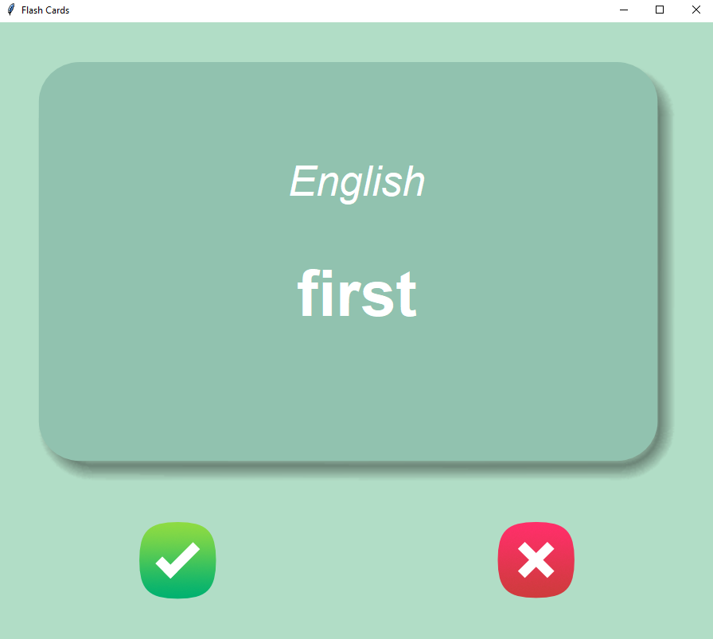

# Password Manager, Tkinter GUI

## Introduction

This program helps you to learn french, you will see a french word, user have 2 seconds to hit check mark button to tell the program
that already know it, after 2 seconds you will see the english translation.

The first time running the program, loads words from french_words.csv file, but when you hit the check_mark button, 
that word will be remove from the list and new file is created (words_to_learn.csv) only with the words to learn. Next time you run the program, 
it loads the words_to_learn.csv, if you want to start over just remove words_to_learn.csv file

## Dependencies

| File      | Description |
| ----------- | ----------- |
| main.py       | main program file |
| data/french_words.csv | loaad data first time |
| images  | |
| card_front.png | front of the card   |
| card_back.png | back of the card |
| right.pnh | image for check_mark button |
| wrong.png | image for x button |

